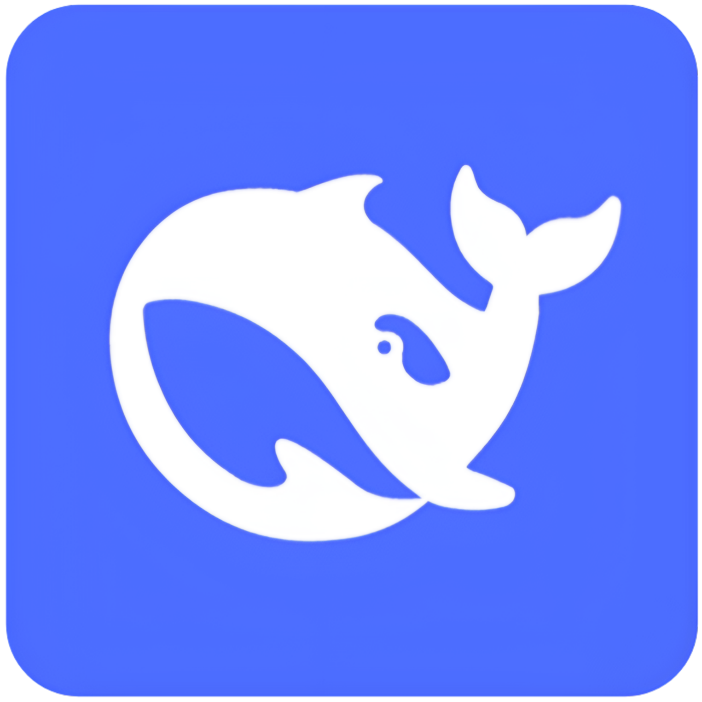

##### Языки:
[](README.md) &nbsp; 
[](README.zh-CN.md) &nbsp;
[](README.ru.md)  

#  DeepSeek in Sidebar


Расширение для Firefox, которое показывает DeepSeek в боковой панели браузера. Оно добавляет в боковую панель новый раздел с веб-приложением DeepSeek, а также сочетание клавиш и кнопку на панели инструментов для её переключения.

[](https://addons.mozilla.org/en-US/firefox/addon/deepseek-in-sidebar/)

## Использование

1. Нажмите _`Alt+Shift+D`_, чтобы открыть или закрыть боковую панель. Это сочетание можно изменить в разделе _`Дополнения` → `DeepSeek in Sidebar` → `Настройки`_.
2. Если вам удобнее кнопки, нажмите кнопку на панели инструментов, чтобы переключить боковую панель.

## Как разблокировать ширину боковой панели Firefox

По умолчанию ширина боковой панели в Firefox _заблокирована_. К сожалению, боковая панель очень ограничена, и расширение может улучшить её работу лишь отчасти. Ниже пошаговая инструкция, как снять это ограничение.

### Пошаговая инструкция

1. Откройте в новой вкладке `about:support`.
2. В разделе _Основная информация о приложении_ (_Application Basics_) найдите _Папка профиля_ (_Profile Folder_).
3. Нажмите кнопку `Открыть папку` (`Open Folder`) рядом с ней. Рядом будет адрес вида: `%appdata%\Mozilla\Firefox\Profiles\{profile-id}.default`.
4. Внутри папки профиля Firefox создайте новую папку с именем `chrome`.
5. Внутри созданной папки `chrome` создайте файл с именем `userChrome.css`.
6. Скопируйте следующий код, вставьте его в файл и сохраните:

```css
#sidebar-box {
  max-width: 40% !important;
  min-width: 300px !important;
}
```

7. Затем откройте в новой вкладке `about:config`, найдите параметр `toolkit.legacyUserProfileCustomizations.stylesheets` и установите значение `true`.
8. Перезапустите Firefox и проверьте результат!

## ⚠ Отказ от ответственности

Это расширение является независимым проектом, не связано с DeepSeek и не аффилировано с ним никоим образом. Расширение предназначено в первую очередь для личного использования, это, можно сказать, личный проект. Дополнение <i>только</i> открывает веб-приложение DeepSeek в боковой панели.

## © Лицензия

Исходный код в этом репозитории доступен по [лицензии MIT](LICENSE).
